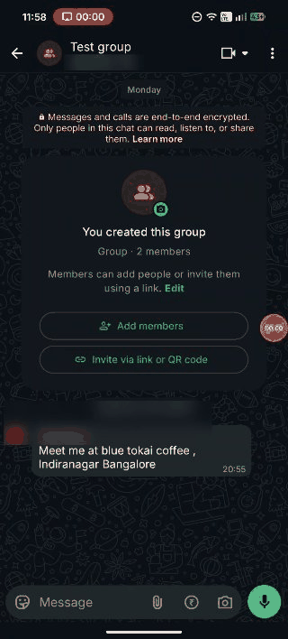

<div align="center">


# Pocket Agent

**An on-device AI agent for Android that operates apps and your phone autonomously.**

It works directly through a floating bubble on your screen—zero PC, zero ADB, zero backend.

<a href="https://github.com/ManojDevarajulu/PocketAgent/releases/latest"></a>

<a href="https://github.com/ManojDevarajulu/PocketAgent/stargazers"></a>
<a href="https://github.com/ManojDevarajulu/PocketAgent/releases/latest"></a>
<a href="LICENSE"></a>
<a href="ACCEPTABLE_USE.md"></a>

<br/>
<br/>

<p>
  <a href="#key-differentiators">Key Features</a> •
  <a href="#how-it-works">How It Works</a> •
  <a href="#supported-providers-byok">Providers</a> •
  <a href="#building-from-source">Build from Source</a> •
  <a href="#documentation">Documentation</a>
</p>

</div>

<p align="center">
  
</p>

---

> [!TIP]
> **Ready to try it on your phone?**  
> Download the pre-built standalone APK directly from **[GitHub Releases (v0.2.0)](https://github.com/ManojDevarajulu/PocketAgent/releases/latest)** — zero development tools or PC required.

---

## What is Pocket Agent?

Most mobile AI agents require a computer running Python, `adb`, and a USB cable connected to your phone.

**Pocket Agent lives directly on your phone.** It is a standalone, open-source Android app that operates your phone autonomously through a floating overlay bubble—with **no computer, no `adb`, no root, and no cloud backend**.

You bring your own API key (Anthropic, OpenRouter, OpenAI, Gemini, DeepSeek, Groq, or a local Ollama server) and select the model you want to use. Pocket Agent observes the active screen, plans the required actions, and performs gestures natively through an Android `AccessibilityService`.

---

## Key Differentiators

* 🎯 **Contextual Trigger over Chat**: You never leave your current app to open a chat window. Tap the bubble directly over whatever is on screen, speak or type your instruction, and the agent acts immediately.
* ⚡ **Zero-PC, Zero-Backend Privacy**: No tethered laptops, no cloud backend, and no telemetry. (The optional [Computer Link](docs/COMPUTER_LINK.md) is the one exception, and it is off until you switch it on.) The app runs locally on your phone and calls your chosen AI provider directly. Screen content is sent only to your chosen provider.
* 🛡️ **Deterministic Safety Gate**: Plain Kotlin rules (not the AI) protect your privacy before any action runs:
  * Sensitive apps (banking, payments, crypto, password managers, system settings) are **blocked**.
  * Irreversible actions (*"Pay"*, *"Send"*, *"Delete"*, *"Order"*) pause execution and require explicit user confirmation.
  * Screen text is wrapped in untrusted data boundaries to prevent adversarial prompt injection.
  * API keys are encrypted on-device with **Android Keystore AES-256 GCM** and protected with `FLAG_SECURE`.
* 🔊 **Hands-Free Voice Loop**: With *Talk back* enabled, tasks can be run completely by voice. The agent speaks action captions aloud and requests confirmations verbally; only an unambiguous *"yes"* (or the screen Approve button) continues execution.
* ⚡ **Pull-Down Quick Settings Tile**: Access Pocket Agent instantly from Android's notification pull-down shade without keeping the floating bubble on screen.
* 🚀 **One-Step Shortcuts**: Where Android has a direct route, the agent uses it instead of tapping through apps: directions, a call or text with the number and words filled in, a web search, an alarm or timer, opening a link, or a calendar event with the details filled in. Sending, calling and saving are still a separate tap that you confirm.
* 🎬 **Record My Routine**: Do a task once with **Record my routine** and get a playbook draft. It keeps only the buttons you tapped and the screens that opened. Anything you typed, password fields, personal-looking labels and blocked apps are never recorded, and you review the draft before sharing it.
* 👁️ **Sees What Accessibility Can't**: For games and custom-drawn apps that expose almost nothing to read, vision models get a screenshot with a grid labelled in real pixels, so they can tap accurately.
* 🖥️ **Computer Link (optional)**: Let Claude Code, Cursor or any MCP app on your own computer hand tasks to your phone over your Wi-Fi. Every task needs your approval on the phone. See [below](#computer-link-optional-off-by-default).
* 🪶 **Lighter Mode (experimental)**: Sends the AI only what changed on the screen each step, so tasks can be quicker. Off by default.
* 📖 **Community Playbooks**: App navigation heuristics are written as concise Markdown guides bundled inside the APK. Anyone can contribute a playbook for their favorite app via a standard GitHub Pull Request.

---

## Computer Link (Optional, off by default)

Let Claude Code, Cursor or any MCP app on your own computer hand tasks to your phone over your home Wi-Fi. Switch it on in **Settings > Computer link**, tap **Copy connect command**, and paste it in a terminal. Every task shows its exact words on the phone and waits for your *Allow* before anything runs; anything that sends, calls or pays is still confirmed again. It exposes one tool, `run_task`, and never lets the computer read or tap the screen directly. See [docs/COMPUTER_LINK.md](docs/COMPUTER_LINK.md).

---

## Private Notifications & OTPs (Optional)

Enable Notification Access in setup to let the agent read and reply to messages without opening apps. This is disabled by default:

* **Minimal Footprint:** Only reads notifications currently in the shade while a task is running or when tapping **Latest OTP**. No persistent background listener or permanent storage.
* **Sensitive App Filtering:** Notifications from banking and payment apps are filtered out entirely.
* **On-Device OTP Masking:** Verification codes are automatically masked (`••••••`) before screen text reaches the AI. **Latest OTP** displays the newest code on a secure local card with zero AI calls.
* **Safe Notification Replies:** Outbound replies are capped at 200 characters and strictly require your manual approval before dispatch.

---

## How It Works

```text
┌─────────────────┐
│  Active Screen  │
└────────┬────────┘
         │ (Tap Floating Bubble or Quick Settings Tile)
         ▼
┌─────────────────────────────────┐
│ Screen Node Capture & Filter    │ ──► Password & system UI redacted
└────────┬────────────────────────┘
         │
         ▼
┌─────────────────────────────────┐
│ System Prompt + Bundled Guide   │ ──► App Playbook injected for current app
└────────┬────────────────────────┘
         │
         ▼
┌─────────────────────────────────┐
│ LLM Provider (Anthropic/OpenAI) │ ──► Direct BYOK API call
└────────┬────────────────────────┘
         │ (Strict Single-Tool Call)
         ▼
┌─────────────────────────────────┐
│   Deterministic Safety Gate     │ ──► Blocked app? -> Abort
└────────┬────────────────────────┘     Risky action? -> User Confirmation Card
         │ (Approved)
         ▼
┌─────────────────────────────────┐
│   Native Accessibility Action   │ ──► Tap / Scroll / Type / Navigate
└────────┬────────────────────────┘
         │
         ▼
┌─────────────────────────────────┐
│   Screen Settle & Loop Repeat   │ ──► Max 25 steps | Stuck detection
└─────────────────────────────────┘
```

---

## Supported Providers (BYOK)

Pocket Agent communicates directly with provider endpoints using a hardened OkHttp transport (redirects disabled, 90s timeout, 2MB response cap, API key masking):

| Provider | Protocol / Type | Capabilities & Notes |
|---|---|---|
| **Anthropic** | Messages API | Prompt caching and thinking-block preservation |
| **OpenRouter** | OpenAI-compatible | Access 100+ models with one API key |
| **OpenAI** | OpenAI-compatible | Any current OpenAI model that supports tool calling |
| **Gemini** | OpenAI-compatible endpoint | High-speed multimodal inference |
| **DeepSeek** | OpenAI-compatible | Use the current model names from DeepSeek's docs (older names get retired) |
| **Groq** | OpenAI-compatible | Ultra-low latency inference |
| **Ollama** | Local OpenAI-compatible | Runs on your own computer or network, so nothing goes to a cloud service; plain `http` is allowed for local LAN |
| **Custom** | OpenAI-compatible | Any custom or self-hosted endpoint |

> **Model Compatibility**: Pocket Agent has no built-in model list, so new models work the day a provider releases them, and old names are never the app's problem. Type any model identifier that supports **tool calling** and tap **"Test the model"** during setup to verify with a lightweight probe.

---

## Quick Install (APK)

1. Open **[Releases](https://github.com/ManojDevarajulu/PocketAgent/releases/latest)** on your phone.
2. Download `pocket-agent-v0.2.0.apk`.
3. Tap the downloaded file to install *(enable "Install unknown apps" if prompted)*.
4. Launch **Pocket Agent** and follow the guided setup checklist.

---

## Building from Source

### Prerequisites
* Android phone running **Android 11 or newer** (API 30+). Tested on a physical Android 16 phone and an Android 17 emulator.
* Java 17+ / Android Studio SDK with Build-Tools.

### 1. Clone the repository
```bash
git clone https://github.com/ManojDevarajulu/PocketAgent.git
cd PocketAgent
```

### 2. Run unit tests
```bash
./gradlew testDebugUnitTest
```

### 3. Build & install debug build
Connect your phone with USB debugging enabled:
```bash
./gradlew assembleDebug
adb install -r app/build/outputs/apk/debug/app-debug.apk
```

---

## Guided Onboarding Checklist

When you launch Pocket Agent for the first time:
1. **Privacy Notice:** Review the on-device security model.
2. **AI Provider & Key:** Select your provider, paste your key, and verify with **"Test the model"**.
3. **Accessibility Service:** Enable Pocket Agent *(on Android 13+, tap the 3-dot menu in App Info $\rightarrow$ "Allow restricted settings" if prompted)*.
4. **Permissions:** Grant optional microphone access for voice tasks and notification access for message summaries.
5. **Floating Bubble:** Toggle the bubble ON and launch your first task.

---

## Project Structure & Decoupling

Pocket Agent enforces strict architectural boundaries:

```text
app/src/main/
  assets/playbooks/        Bundled Markdown navigation guides per app package
  kotlin/dev/pocketagent/
    agent/                 AgentLoop, AgentRunner, StuckDetector, Tools, Captions
    bridge/                McpHandler, McpHttpServer, PairingToken (the optional Computer Link)
    device/                DevicePort, ScreenNode, ScreenSerializer, Settler, Revalidator
    llm/                   AnthropicClient, OpenAiCompatClient, OkHttpTransport, ProviderConfig
    safety/                SafetyGate, BlockedApps, RiskyLabels
    playbook/              Playbook, PlaybookStore, RoutineRecorder
    setup/                 SetupModel, StoredConfigRepository
    android/               PocketAccessibilityService, PocketNotificationListener, PocketTileService, AccessibilityDevice
    ui/                    BubbleOverlay, CaptionView, ConfirmCard, SummaryCard, SetupActivity
```

> **Clean Architecture Guarantee**: Core packages (`agent`, `bridge`, `device`, `llm`, `safety`, `playbook`, and `setup`) contain **zero Android framework dependencies**. All core decision logic is verified via fast JVM unit tests with deterministic fakes.

---

## Contributing

Contributions are welcome! You can contribute code, documentation, or **App Playbooks** (15-line Markdown navigation heuristics for popular apps).

* Read [CONTRIBUTING.md](CONTRIBUTING.md) for development guidelines, coding standards, and playbook specifications.
* Report security vulnerabilities privately as detailed in [SECURITY.md](SECURITY.md).

---

## Documentation

* [Architecture Deep Dive](docs/ARCHITECTURE.md): Agent loop, accessibility tree serializer, and overlay system
* [Computer Link](docs/COMPUTER_LINK.md): Connect Claude Code or another MCP app on your computer, and how it is locked down
* [Security Model](docs/SECURITY_MODEL.md): Threat model, blocked apps, Keystore encryption, and safety gate
* [Safety & Ethical Guidelines](ACCEPTABLE_USE.md): Community guidelines, intended use, and responsible development
* [Third-Party Notices](THIRD_PARTY_NOTICES.md): Licenses for bundled fonts and libraries
* [Changelog](CHANGELOG.md): Release history and version updates
* [Testing Checklist](docs/TESTING.md): JVM unit tests and physical-device verification procedure

---

## License

Licensed under the **[GNU Affero General Public License v3.0 (AGPL-3.0)](LICENSE)**.  
Please review our community **[Safety & Ethical Guidelines](ACCEPTABLE_USE.md)**.

Copyright (c) 2026 Manoj Devarajulu and Pocket Agent contributors.
